# Colby's SocialApp — React Native

<div align="center">
  

  <h3>Social Networking Mobile Application</h3>

  <p>A modern social networking experience built with React Native.</p>

  [](https://reactnative.dev/)
  [](https://www.mongodb.com/)
  [](https://code.visualstudio.com/)

</div>

---

## Overview

**Colby's SocialApp** is a React Native mobile application designed to provide an interactive social networking experience.

The application includes user authentication, profile management, social posts, comments, messaging, and notifications.

### Technology Stack

- **Mobile Framework:** React Native
- **Database:** MongoDB
- **Authentication:** JSON Web Tokens (JWT)
- **Development Environment:** Visual Studio Code
- **Development Tools:** Expo, npm
- **API Integration:** REST APIs

---

## Features

### Authentication & User Management
- Secure authentication using JWT.
- Password recovery functionality.
- User profile management and editing.
- Follow and unfollow other users.

### Social Networking
- Create, edit, and delete posts.
- Like and unlike posts.
- Add and delete comments.
- Discover and connect with users.
- View user profiles and activity.

### Messaging & Notifications
- Private messaging between users.
- Chat conversation management.
- Notifications for incoming messages.

---

## Application Screenshots

<div align="center">

### Authentication, Home & Profile

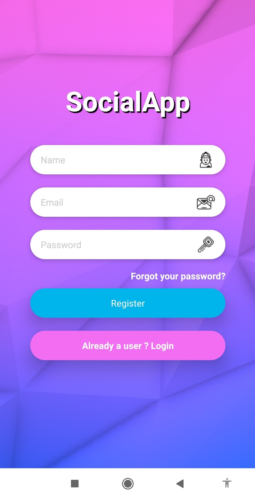
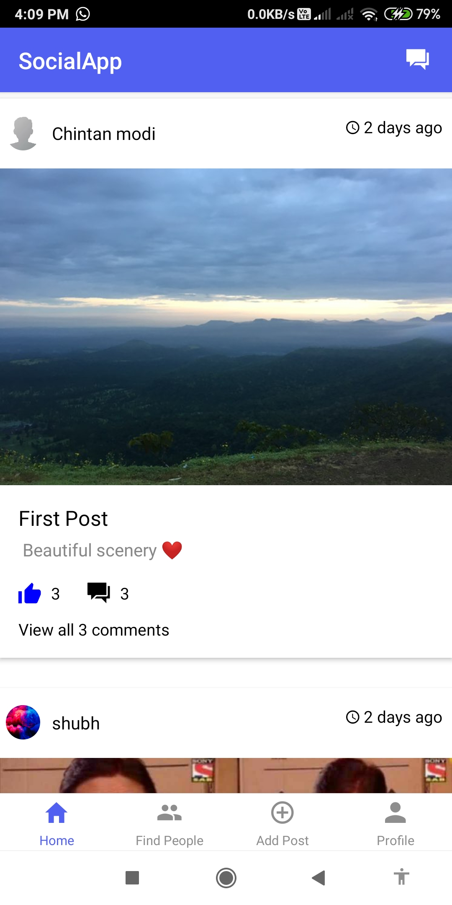
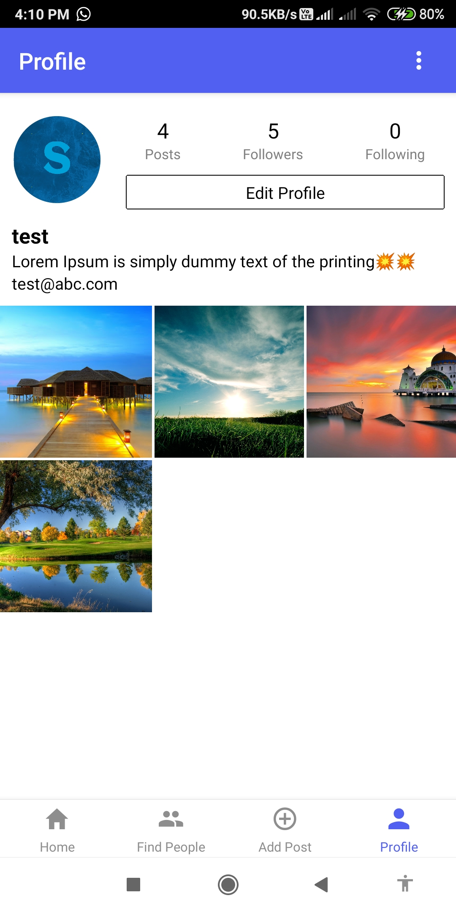

### Posts, Statistics & User Discovery

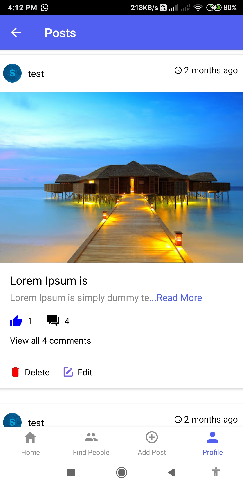
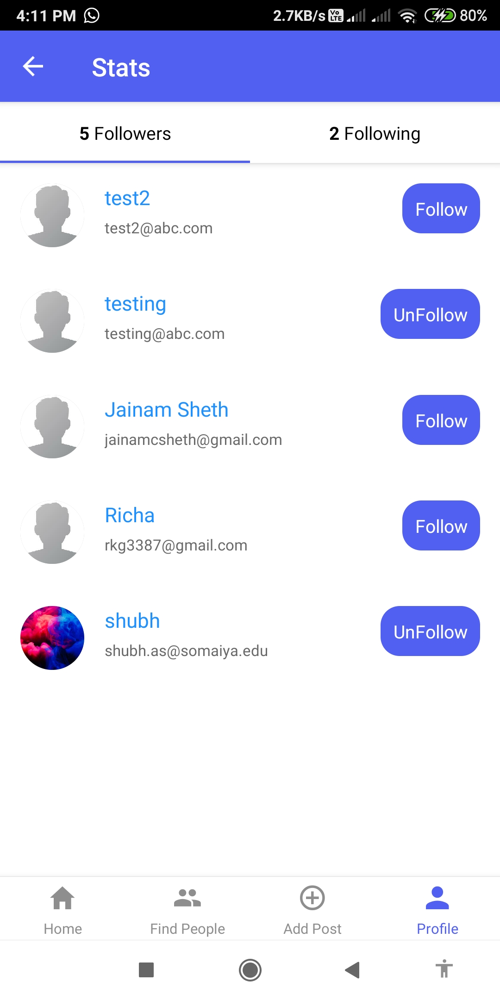
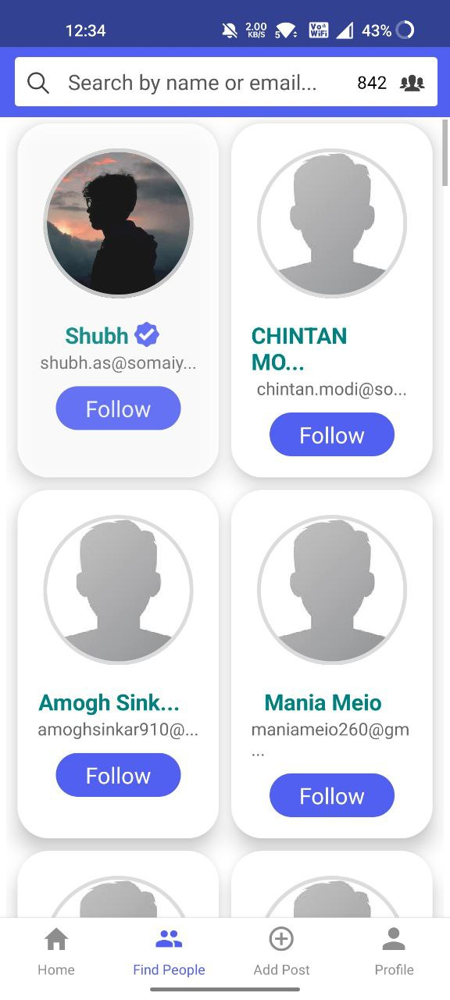

### Messaging & Comments

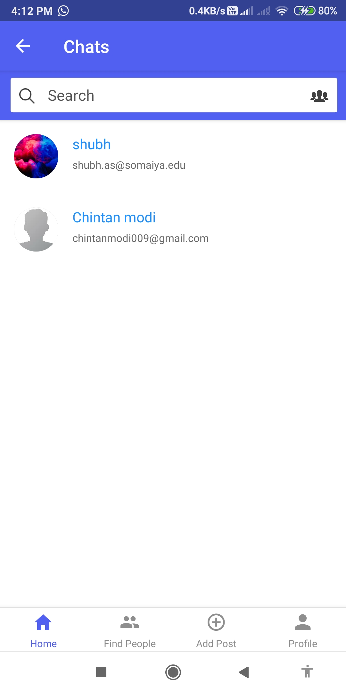
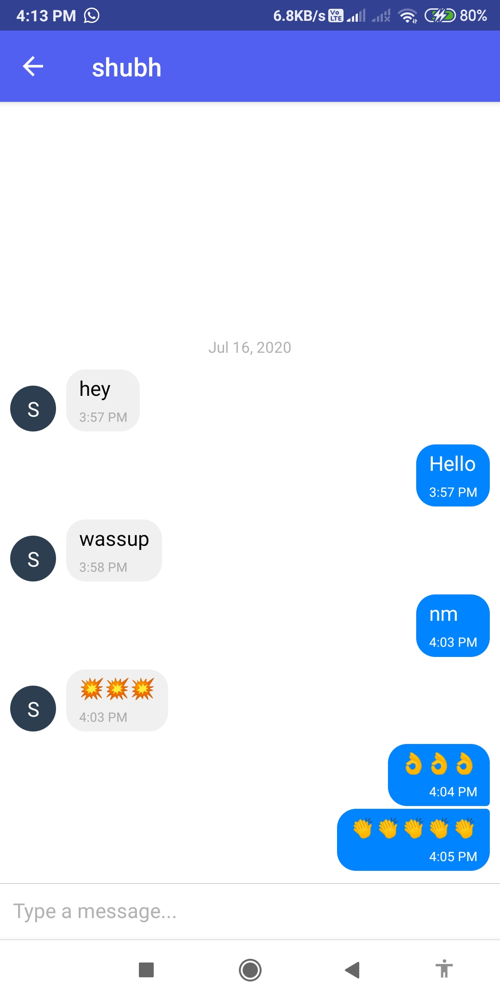
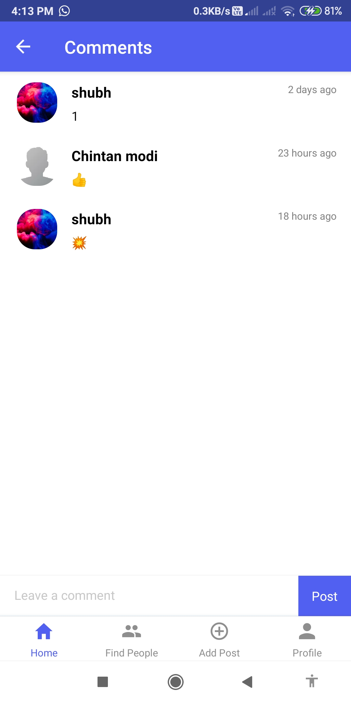

### Post Creation & Notifications

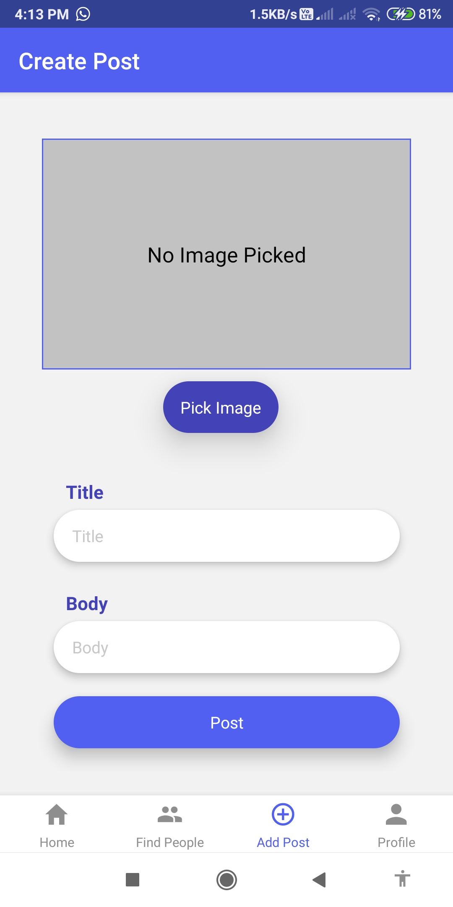
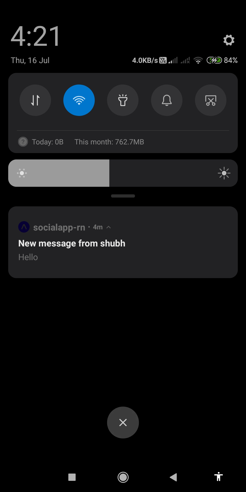

</div>

---

## Getting Started

### Prerequisites

Before running the application, make sure you have:

- Node.js and npm
- Git
- Expo-compatible development environment
- Android emulator or iOS simulator
- A running backend API

### 1. Clone the Repository

```bash
git clone https://github.com/BeanColby44/SocialApp-React-Native.git
```

### 2. Navigate to the Project Directory

```bash
cd SocialApp-React-Native
```

### 3. Install Dependencies

```bash
npm install
```

### 4. Configure Environment Variables

Create a file named `env.js` in the project root directory.

```javascript
const vars = {
  apiUrl: "YOUR_BACKEND_API_URL",
  defaultImageUri: "YOUR_BACKEND_API_URL/static/images/defaultprofile.jpg"
};

export default vars;
```

Replace `YOUR_BACKEND_API_URL` with your own backend server address.

### 5. Start the Application

```bash
npm start
```

Run the application using the options supported by your installed Expo version.

For more information, refer to the [React Native documentation](https://reactnative.dev/docs/getting-started).

---

## Project Structure

The application includes the following core functionality:

- User authentication
- Profile management
- Social feed
- Post management
- Likes and comments
- User discovery
- Private messaging
- Notifications
- Backend API integration

---

## Developer

**Colby Lee Bean**

Software Engineer | Full-Stack & Mobile Development

**GitHub:** [BeanColby44](https://github.com/BeanColby44)

**Email:** colby.bean@outlook.com

---

<div align="center">

**Developed and maintained by Colby Lee Bean**

[GitHub Profile](https://github.com/BeanColby44)

</div>